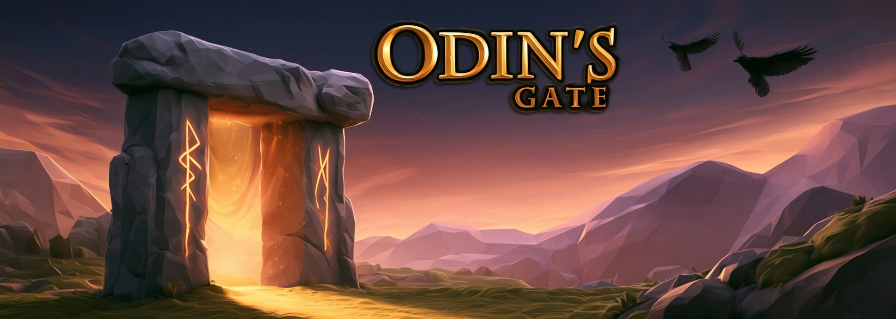

<div align="center">

<picture>
  <source media="(prefers-color-scheme: dark)" srcset=".github/readme/banner-dark.jpg">
  
</picture>

**Odin's Gate is a private Old School RuneScape test server, built from the ground up for testing RuneLite plugins against 1:1 recreations of live content.**


[](https://github.com/SamSjosten/OSRSPS/commits/main)


[Quick start](#quick-start) · [Build and run](#build-and-run) · [Run in Docker](#run-in-docker) · [Connect RuneLite](#connect-runelite) · [Testing tools](#testing-tools) · [Commands](#developer-commands)

</div>

---

This repository (OSRSPS) is the server: our own engine in Kotlin on Java 21, with [RSProt](https://github.com/blurite/rsprot) for the network protocol. Every
behaviour is matched tick for tick from the OSRS Wiki and recordings of the live game, and anything guessed is marked
in the code. Current RuneLite connects unchanged.

### What's in it

**By region** (click one to open it)

<details open>
<summary><b>Misthalin</b> · built, about 80% of live's content by the last audit</summary>

| | |
|---|---|
| **Places** | Lumbridge and its swamp and caves, Draynor Village and Manor, Varrock (palace, museum, sewers, Champions' Guild), Edgeville and its dungeon, Barbarian Village, the Wizards' Tower, the Digsite, Silvarea, Paterdomus, the Stronghold of Security |
| **Bosses** | Obor, Bryophyta, Scurrius |
| **Raids** | The Fractured Archive, under the Lumbridge Swamp caves past the Chasm of Tears: the Guardian statues, Bork, the Smorks, Dreadnoth, Xarth, Moia, Dagon'hai, Ocellus |

</details>

<details>
<summary><b>Kharidian Desert</b> · Al Kharid only</summary>

| | |
|---|---|
| **Places** | Al Kharid (palace, Emir's Arena), Shantay Pass |
| **Bosses** | None yet |

</details>

<details>
<summary><b>Wilderness</b> · being built, more bosses to come</summary>

| | |
|---|---|
| **Places** | Every level, the Ferox Enclave, the Chaos Temple, the Lava Maze, the Mage Arena bank, the Resource Area, Rogues' Castle, the obelisks and levers |
| **Bosses** | King Black Dragon, Chaos Elemental, Chaos Fanatic, Crazy Archaeologist, Scorpia, Artio |

</details>

<details>
<summary><b>Karamja</b> · being built, with Mor Ul Rek</summary>

| | |
|---|---|
| **Places** | The boat from Port Sarim to Musa Point |
| **Bosses** | The Fight Caves (being built) |

</details>

**Skills**

| | |
|---|---|
| **Built in full** | Attack, Strength, Defence, Hitpoints, Ranged, Prayer, Mining, Smithing, Fishing, Cooking, Woodcutting, Firemaking, Fletching, Crafting, Herblore, Thieving, Runecraft, Farming |
| **Built in part** | Magic (no Alchemy or Superheat Item yet), Agility (the Draynor, Al Kharid, Varrock and Gnome Stronghold courses), Slayer (no Task Storage, ring teleports or boss tasks), Hunter (no birdhouses, herbiboar, Hunter Guild or Puro-Puro), Construction (houses only) |

A skill built in full trains 1 to 99 by live's main methods; spots outside the built regions are reached with `::tele`
until their region is built. Minigames and other regions' extras (Wintertodt, Tempoross, Guardians of the Rift and so
on) come with their areas.

**Getting around**: lodestones, every fairy ring (with a dramen or lunar staff wielded) and every spirit tree.

### Quick start

```bash
./gradlew run --args=fetch-cache                    # once: download the live cache into data/
OSRSPS_LOCAL_KEY=1 ./gradlew run --args=serve       # game on 43594, launcher files on 43595
```

Then point RSProx at `http://<host>:43595/proxy-targets.yaml` ([Connect RuneLite](#connect-runelite)) and log in
with any new name. `OSRSPS_LOCAL_KEY=1` makes the server generate its own login key, since the live one stays
out of git (see Build and run).

### More docs

| File | What's in it |
|------|--------------|
| [`CONTRIBUTING.md`](CONTRIBUTING.md) | How pull requests move: auto-merge, the queue, conflicts, revision bumps |
| [`AGENTS.md`](AGENTS.md) | Review guidelines, sourcing (`// Guessed:`, `// Inferred:`), what never goes in git |
| [`deploy/README.md`](deploy/README.md) | How our own server (VM 214) deploys itself, cache swaps and rollbacks, the staging server, the settings it runs with |
| [`test-runner/README.md`](test-runner/README.md) | The RuneLite test runner, its script format, headless runs |
| [`TRIAGE.md`](TRIAGE.md) | How filed problem reports are triaged |
| [`NOTES.md`](NOTES.md) | Each step's build notes as it merged. Not kept in step with the code; the code wins |

## Never commit Jagex files

> [!CAUTION]
> The game cache, the client, XTEA keys, RSA keys, gameplay recordings and the words NPCs say stay out of git. They live
> under `data/` (git-ignored) on the machine that runs the server.

## Build and run

Needs JDK 21; the Gradle wrapper fetches Gradle. On Windows use `.\gradlew.bat` the same way.

```bash
./gradlew build                                  # compile and run the tests
OSRSPS_LOCAL_KEY=1 ./gradlew run --args=serve    # game on 43594, launcher files on 43595
```

| `--args=` | What it does |
|-----------|--------------|
| `serve [port]` | Runs the server: game and JS5 on the port (43594), launcher files on the next one |
| `fetch-cache [build]` | Downloads the revision's cache and XTEA keys from [OpenRS2](https://archive.openrs2.org) into `data/cache/`, keeping the old one in `data/cache.previous`. With a build (`242`), only if that is OpenRS2's newest; else exits 3 |
| `cache-info` | Summarises the cache in `data/` |
| `collision x z [level]` | Prints what the server thinks is walkable around a tile |
| `dialogue-keys` | Writes `data/dialogue.txt` with every key, keeping the words already there (see Dialogue words) |
| `set-password name` | Sets an account's password (see Accounts) |
| `import-model in.obj out.dat [...]` | Converts a Wavefront OBJ to a client model for `data/models/<id>.dat` (run it bare for its options) |
| `import-sprite in.png out.dat` | Converts an image to a client sprite for `data/sprites/<id>.dat` |

Everything the server reads lives in `data/` (`OSRSPS_DATA` points at another folder), and it won't start on a cache
of another revision. The login key is `data/rsa.key`; `serve` refuses one that doesn't match the committed modulus
(`src/main/resources/rsa-modulus.txt`, which the launcher carries), so a local server sets `OSRSPS_LOCAL_KEY=1` and
generates its own.

## Run in Docker

```bash
docker compose up -d --build      # build and start
docker compose logs -f            # follow the log
docker compose run --rm osrsps collision 3222 3218
```

Settings are in `compose.yaml`'s `environment:`:

| Variable | Meaning |
|----------|---------|
| `OSRSPS_ADMINS` | Names that may run admin commands (comma separated). Unset means everyone, with a warning in the log |
| `OSRSPS_PUBLIC_HOST` | Host the launcher files point at when a request has no usable Host header |
| `OSRSPS_RELAYS` | Relay addresses allowed to send a PROXY protocol header |
| `OSRSPS_PROXY_PROTOCOL` | `optional` (default), `required` or `off`, for relay connections |
| `OSRSPS_SEED` | Fixed random seed at startup; unset picks one and logs it |
| `OSRSPS_REPORTS_REPO` | Repository problem reports are filed in |

Our own server (VM 214) redeploys itself from `main`, and any branch can run next to it on the staging server: both in
[`deploy/README.md`](deploy/README.md).

## Connect RuneLite

Players connect with the unchanged RuneLite client, through one of two routes.

### RSProx client

Install [RSProx](https://github.com/blurite/rsprox). In it press **+** next to the proxy target selector, **From URL…**,
paste `http://<host>:43595/proxy-targets.yaml` and restart RSProx. The server fills in its login key and the RuneLite
build pinned for its revision. Our own server's addresses and SSH tunnel are in [`deploy/README.md`](deploy/README.md).

### Odin's Gate launcher

Friends install Odin's Gate, our launcher, from [its download page](https://samsjosten.github.io/OdinsGate/), and it
connects them to `odinsgate.net`. The launcher lives in the
[OdinsGate repository](https://github.com/SamSjosten/OdinsGate); `CONTRIBUTING.md` covers the files the two share.

The launcher's **Send problem report** button files the report as a GitHub issue, triaged by
[`TRIAGE.md`](TRIAGE.md). Setting that up (the token on the server) is in `deploy/README.md`.

## Accounts and admins

The first login as a name claims it with the password typed; after that only that password works. Names ignore case
and treat spaces as underscores. Names with `@` and names that break live's display name rules are refused. Five
wrong passwords lock a name for 5 minutes. A name in `OSRSPS_ADMINS` can't be claimed, so claim it first, then list it.

Accounts are `data/accounts/<name>.json` and saves `data/saves/<name>.json`; deleting a name's account file resets
it. To set a password (12 characters or more, no restart):

```bash
docker compose exec osrsps bin/osrsps set-password <name>                       # in Docker
./gradlew installDist && build/install/osrsps/bin/osrsps set-password <name>   # from a checkout
```

`::ipban` bans an address (kept in `data/ip-bans.txt`); behind the relay that is the player's own address.

## Dialogue words

Dialogue, examine text and game messages are Jagex's, so code holds keys (`[hans.greeting]`) and the words live in
`data/dialogue.txt` on the server, one `key = words` a line. A key with no words shows as the key in brackets, so
everything runs and is tested without them. `dialogue-keys` rewrites the file with every key in place (the old one goes
to `dialogue.txt.bak`), `::dialogue` reloads it without a restart, and `::keys` shows keys instead of words. Each
conversation is a `Lines` object listed in `DialogueLines.ALL`; examines come from `src/main/resources/examines.json`.

## Testing tools

- **Tick control.** The game ticks every 600 ms in fixed phases (`TickPhase`). `::pause` freezes it after the current
  tick, `::step [n]` runs n ticks, `::resume` restarts it. While paused, commands still answer; clicks wait for the
  next tick.
- **Random seeds.** Every roll comes from `World.random` (`GameRandom`, xoshiro256\*\*), and a test fails if `src/main`
  uses anything else. `OSRSPS_SEED` or `::seed n` fixes it; `::pause`, `::seed n`, set up, then `::step` repeats a
  run.
- **Scenarios.** `::scenario name` sets position, stats, inventory, equipment, bank and vars in one go; `::reset` puts
  you back as you were before your first one, across logouts too. They are JSON files in
  `src/main/resources/scenarios/`, listed in `Scenarios.FILES`, format in `game/Scenario.kt`.
- **The rotten potato.** `::item 5733`. Its Eat, Slice, Peel and Mash menus run the `::` commands (stats, wipe, heal,
  teleports, spawns, god mode, sure hits, XP rate, scenarios, logout, death), so admins can test from the menus.
- **Headless test client.** `src/test/kotlin/osrsps/testclient/` speaks the real protocol, and `TestServer` runs the
  world with no cache and 100 ms ticks, so content is tested in `./gradlew test`. `./gradlew headlessScripts` plays
  the runner's scripts against the live cache without RuneLite (`test-runner/README.md`).
- **The RuneLite test runner.** `test-runner/` is a sideloaded plugin that plays JSON scripts in the real client on
  the test VMs (215, 217), for test accounts only. `tick-recorder/` records what the client sees each tick.

## Developer commands

Type them in the chatbox. Click a group to open it. Only admins (`OSRSPS_ADMINS`) can run them, except those marked **everyone**, which are
safe for any player: they read the world, show you something or do what a player could do anyway. A dead player can run only those. An unknown command lists the ones you
can use. Commands live in `src/main/kotlin/osrsps/game/command/`; register new ones on `World.commands`, next to
related ones.

<details open>
<summary><b>Position and world</b></summary>

| Command | What it does |
|---------|--------------|
| `::pos` | **everyone.** Your `x, z, level`, the region and your tile in it |
| `::tele x z [level]` | Teleports there; `::pos` output pastes in |
| `::teleto name` | Teleports onto a player |
| `::wildy level` | Jumps to that Wilderness level north of Edgeville |
| `::lodestone [site]` | **everyone.** Opens the lodestone map, or casts to an activated stone |
| `::instance [radius]` / `::instance leave` | A private copy of the map around you, or back out of it |
| `::locs [radius]` | **everyone.** Locs near you: id, name, tile, shape, angle, and whether they differ from the cache |
| `::addloc id [shape] [angle]` / `::delloc` | Puts a loc on your tile, or removes every loc there |
| `::resetlocs [radius]` | Puts nearby locs back as the cache has them |
| `::los npcIndex` / `::los dx dz` | **everyone.** Distance, line of sight and hit delays to an NPC or tile |

</details>


<details>
<summary><b>Ticks, seeds and scripts</b></summary>

| Command | What it does |
|---------|--------------|
| `::tick` | **everyone.** The tick number and whether the clock is paused |
| `::pause` / `::step [n]` / `::resume` | Freezes the clock, runs n ticks (up to 1000), starts it again |
| `::seed [n]` | Shows the seed and rolls drawn, or restarts the rolls from seed n |
| `::star [sites \| land [site\|here] [size] \| next ticks \| layer \| clear \| bonus [n] \| scout oak\|teak\|mahogany]` | Shows the shooting star and the next landing, or lands, plans, clears one, sets your bonus or looks through a telescope |
| `::queue weak\|normal\|strong\|soft [delay]` | Queues a test script on you |
| `::delay [ticks]` / `::timer normal\|soft interval [times]` / `::timer off` | Delays you, or starts or stops a test timer |
| `::scripts` | **everyone.** What you have queued, delayed and on timers |
| `::scenario [name]` / `::reset` | Starts a scenario (alone, lists them), or ends it |

</details>


<details>
<summary><b>Items, stats and vars</b></summary>

| Command | What it does |
|---------|--------------|
| `::item id\|name [count]` | Adds items by id, menu name or gameval name (`::item coins 10k`) |
| `::empty` | Empties your inventory |
| `::openbank` | Opens your bank anywhere (`::bank` never reaches the server) |
| `::itemprices [refresh]` | Reloads the Grand Exchange price snapshot, or downloads a new one |
| `::setlevel skill\|all level` | Sets a skill's level and XP |
| `::addxp skill xp` | Adds exact XP (one decimal), ignoring the XP rate |
| `::boost skill level` | Sets only the current level (0 to 255) |
| `::stats` | **everyone.** Boosted and drained stats and ticks until each moves back |
| `::statcycles` | Restarts the boost and drain cycles |
| `::xprate [rate\|restore]` | Server-wide XP rate, 0.1 to 1000 (kept in `data/xp-rate.txt`); 1 is live's |
| `::varp id\|name [value]` / `::varbit id\|name [value]` | Shows or sets a var; our own vars go by name (`::varp lodestones`) |
| `::slayer [task <id\|name> [amount] [master] \| points n \| streak n \| clear \| superior]` | Shows or sets your Slayer task, points and streak |
| `::randomevent [list\|now\|on\|off\|<event>]` | Your random event status; lists, brings on, turns off or sends one |
| `::look [body a\|b \| kit part id \| colour part n \| reset \| design]` | Shows or sets your body type, kits and colours (and shows your pronouns); `design` opens the Character Creator |
| `::farmtick [ticks]` / `::farmclock pause\|run` / `::farmdisease patch\|off\|on` | Moves, holds or runs your farming clock; makes a patch diseased or stops disease |
| `::nest [seeds\|ring\|red\|green\|blue]` | Drops a bird's nest as a tree would |

</details>


<details>
<summary><b>Combat</b></summary>

| Command | What it does |
|---------|--------------|
| `::combat [index\|name]` | **everyone.** Attack rolls and max hits against an NPC |
| `::fight` | **everyone.** What you are fighting and ticks to your next swing |
| `::hp` | **everyone.** Your hitpoints and who is attacking you |
| `::drops [index\|name]` | **everyone.** An NPC's drop table |
| `::god [on\|off]` / `::sure [on\|off\|max]` | You can't be hurt; your attacks can't miss (`max`: melee hits max too) |
| `::heal` / `::hit damage [index\|name\|me]` / `::kill [index\|name]` | Heals you, hits an NPC or you, kills an NPC |
| `::prayers` / `::pray points` | **everyone** for `::prayers`. Active prayers and points; sets points |
| `::spec [percent]` | Shows or sets special attack energy |
| `::poison [severity\|venom\|cure]` / `::poison npc severity\|venom [index\|name]` | Poisons, envenoms or cures you or an NPC |
| `::drain stat levels\|percent% [index\|name]` | Drains an NPC's stat up to its cap |
| `::stun [ticks\|end]` | Stuns you, or ends it |
| `::multi [on\|off]` | Marks your zone multi-way, or single, until a restart |
| `::spellbook [name]` | Shows or switches your spellbook |
| `::blowpipe [dart darts scales]` / `::shadow [charges]` / `::tome [charges]` | Charges a blowpipe or powered staff without the items |
| `::aggro [ticks]` | Your aggression tolerance count, or sets it |
| `::skull [on\|off]` / `::pj` | Gives or removes a skull; clears your PJ timer |
| `::wboss [name]` | Lists or spawns a Wilderness boss |

</details>


<details>
<summary><b>NPCs and ground items</b></summary>

| Command | What it does |
|---------|--------------|
| `::npc id\|name [wander]` | Spawns an NPC on your tile until a restart |
| `::npcs [radius] [mine]` | **everyone.** Nearby NPCs: index, tile, spawn, state and who each is fighting |
| `::delnpc index\|mine` / `::hidenpc index\|mine` | Removes an NPC, or hides and shows it |
| `::npchp hitpoints index\|mine` | Sets an NPC's hitpoints, past its maximum too |
| `::follow index` | An NPC follows you; again to stop |
| `::respawns` | **everyone.** Killed NPCs waiting to respawn and ticks left |
| `::groundobj id\|name [count]` | Puts a public item on your tile |
| `::objspawn id\|name [count [respawn ticks]]` | An item spawn on your tile until a restart |
| `::grounditems` / `::cleartile` | Lists the items on your tile, or clears them |

</details>


<details>
<summary><b>Raid</b></summary>

| Command | What it does |
|---------|--------------|
| `::raidparty [invite\|accept\|kick name \| leave]` | Shows or manages your raid party |
| `::raid boss [phase=] [party=] [seed=]` | Starts a boss fight on your tile; alone, shows the fight or lists bosses |
| `::raid log\|digest\|stop\|run\|tp\|travel\|loot\|clear\|hold` | The fight's log, stops it; in an Archive run, shows it, goes to a room, travels, loots, clears or holds |
| `::raidnpc id\|name [party size]` | Puts in a raid NPC scaled for a party size |

</details>


<details>
<summary><b>Social, Grand Exchange and admin</b></summary>

| Command | What it does |
|---------|--------------|
| `::friends` / `::ignores` | **everyone.** Your lists as the server keeps them |
| `::clearfriends` / `::clearignores` | Empties a list |
| `::clan` / `::guestclan` | **everyone.** Your clan or guest clan |
| `::clanmake name` / `::clanjoin name [recruiter]` / `::clandisband [name]` | Makes, joins or deletes a test clan |
| `::clanguests` / `::clanapplicant` / `::clanbanned` | Shows guest settings, adds the test applicant, shows bans |
| `::clanfounding [founders hours]` | Shows or sets what founding a clan takes |
| `::geoffer buy\|sell item quantity price` / `list` / `abort\|collect slot` | Grand Exchange offers without its screens |
| `::ge` / `::gecollect` / `::gefill slot [amount]` / `::gemarket [on\|off]` | Opens the GE screen or collection box, fills an offer at its price, stops or starts the bot market |
| `::reports` | The newest player reports |
| `::ip [name]` / `::ipban name\|address [note]` / `::ipunban address` / `::ipbans` | Addresses and bans |

</details>


<details>
<summary><b>Client and effects</b></summary>

| Command | What it does |
|---------|--------------|
| `::keys [on\|off]` | **everyone.** Dialogue shows keys instead of words; test scripts turn it on |
| `::dialogue` | Reloads `data/dialogue.txt` and reports problems |
| `::buttons [on\|off]` | **everyone.** Echoes which interface clicks reach the server |
| `::if id [side]` | Opens an interface bare |
| `::ifevents interface component start end events1 [events2]` | Sends IF_SETEVENTS as given |
| `::anim id [delay]` / `::spotanim id [height] [delay] [slot]` | Plays an animation or spotanim on you |
| `::gfx id [height] [delay]` / `::proj id [dx dz]` | Plays a spotanim on your tile, or fires a projectile |
| `::sound [id] [loops] [delay]` / `::jingle id` | **everyone.** Plays a sound or jingle to you |
| `::areasound id [radius] [loops]` | Plays a sound from your tile to everyone in range |

</details>
